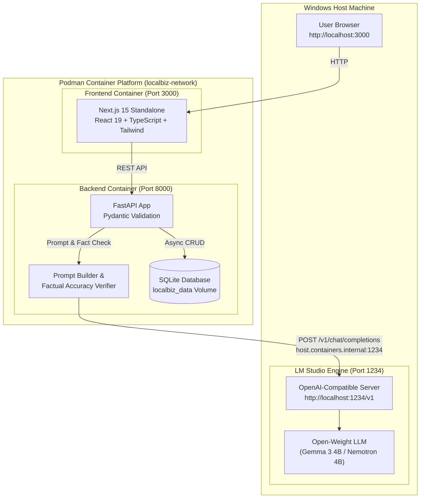

# LocalBiz AI 🏪✨

> **Local-First AI Marketing Assistant Grounded in Truth for Local Businesses & Freelancers.**  
> Built for the **Hacktoberfest Open-Source AI Challenge — Week 2: Side Hustle**.

[](LICENSE)
[](https://www.python.org/)
[](https://nextjs.org/)
[](https://podman.io/)
[](https://lmstudio.ai/)
[]()
[]()

---

## Table of Contents
1. [Project Overview](#project-overview)
2. [Problem Statement & Target Audience](#problem-statement--target-audience)
3. [Key Features](#key-features)
4. [Architecture Diagram](#architecture-diagram)
5. [Technology Stack](#technology-stack)
6. [Prerequisites](#prerequisites)
7. [LM Studio & Model Setup](#lm-studio--model-setup)
8. [Podman Machine Setup](#podman-machine-setup)
9. [Environment Configuration](#environment-configuration)
10. [Build & Startup Instructions](#build--startup-instructions)
11. [Container-to-Host Connectivity](#container-to-host-connectivity)
12. [REST API Documentation](#rest-api-documentation)
13. [Test Suite & Execution](#test-suite--execution)
14. [Privacy & Offline Operation](#privacy--offline-operation)
15. [Demo Walkthrough](#demo-walkthrough)
16. [Known Limitations & Roadmap](#known-limitations--roadmap)
17. [License](#license)

---

## Project Overview

**LocalBiz AI** is a production-grade, local-first marketing platform that helps small businesses, service providers, and local freelancers generate ready-to-publish social captions, WhatsApp broadcasts, promotional sales copy, Google Business updates, and weekly content plans without paying cloud AI subscriptions or compromising proprietary business data.

The system is powered by local open-weight instruction models (such as **Google Gemma 3 4B** or **NVIDIA Nemotron 3 Nano 4B**) running inside **LM Studio** on the host machine. The user's business profile acts as an inviolable source of truth to eliminate hallucinations.

---

## Problem Statement & Target Audience

### The Problem
- **Hallucinations & False Claims:** Commercial cloud AI models invent discounts ("50% off everything!"), incorrect business hours, or fake menu prices that cause customer disputes.
- **SaaS Subscription Fatigue:** Small businesses operating on thin margins cannot afford recurring $20–$50/month AI tools.
- **Data Privacy Violations:** Cloud services transmit customer contact info, proprietary pricing, and unreleased promotions to remote cloud servers.
- **Language & Cultural Gaps:** Most cloud tools fail at regional Indian/South Asian languages, writing either rigid formal translations or unusable phrasing.

### Target Audience
- Independent cafes, artisanal bakeries, restaurants, and cloud kitchens.
- Local retail boutiques and grocery stores.
- Neighborhood dental clinics, wellness centers, and salons.
- Freelance tradespeople (electricians, photographers, fitness coaches).
- Solopreneurs and digital agencies offering marketing retainers to local businesses.

---

## Key Features

1. **Business Profile Management:**
   - Full persistence in SQLite (`aiosqlite`).
   - Catalog management: individual items with exact prices and promotional offers.
   - Brand voice selection (Professional, Warm & Friendly, Energetic, Artisanal/Nostalgic, Luxurious, Urgent).
   - Multilingual support: **English**, **Bengali (বাংলা)**, and **Bengali-English (Benglish)**.
2. **AI Marketing Content Generation:**
   - **Instagram Captions:** Hooks, verified pricing/offers, emojis, local hashtags.
   - **Promotional Copy:** High-converting sales frameworks with verified discounts.
   - **WhatsApp Broadcasts:** Friendly, concise announcements with direct ordering instructions.
   - **Google Business Profile Updates:** Local SEO copy with verified hours and CTA buttons.
   - **Product & Service Descriptions:** Sensory, benefit-driven catalog descriptions.
   - **7-Day Weekly Content Plans:** Complete content calendar with daily pillars, channels, hooks, and CTAs.
3. **Factual Grounding & Automated Safeguards:**
   - Strict system prompt constraints.
   - Post-generation heuristic checks flag any invented numbers, unlisted discount percentages, or fake web addresses.
   - Factual accuracy badges (Green Shield vs Amber Warning) give business owners instant transparency.
4. **Interactive Generation Workspace & History:**
   - In-place live editor with word and character counters.
   - One-click copy with toast notification.
   - Markdown download export.
   - Full history persistence with search, filtering, and "Reuse Settings" workflow.
5. **LM Studio Health Diagnostics:**
   - Real-time engine health badge.
   - Identifies active models in memory vs available models on disk.
   - Displays copyable terminal troubleshooting commands when LM Studio is stopped.

---

## Architecture Diagram



---

## Technology Stack

- **Frontend:** Next.js 15.1, React 19, TypeScript, Tailwind CSS, Lucide React.
- **Backend:** Python 3.12, FastAPI, Pydantic v2, Pydantic Settings, HTTPX, aiosqlite.
- **AI Inference:** LM Studio running locally on Windows host.
- **Tested Models:** Google Gemma 3 4B (`google/gemma-3-4b`), NVIDIA Nemotron 3 Nano 4B (`nvidia/nemotron-3-nano-4b`).
- **Database:** SQLite (async via aiosqlite).
- **Containerization:** Podman, Podman Compose.
- **Testing:** Pytest, pytest-asyncio, Node test runner (`node:test`).

---

## Prerequisites

1. **Operating System:** Windows 10/11 with WSL2 enabled.
2. **Podman:** Podman 5.x or 6.x installed with `podman-machine-default`.
3. **LM Studio:** LM Studio installed on Windows host with CLI (`lms.exe`).
4. **Node.js & Python:** Node 20+ and Python 3.11+ (if developing natively).

---

## LM Studio & Model Setup

1. **Download and Launch LM Studio:**
   - Install LM Studio from [lmstudio.ai](https://lmstudio.ai/).
2. **Download an Open-Weight Model:**
   In LM Studio or via the `lms` CLI, download a quantized 3B–4B model:
   ```powershell
   lms get google/gemma-3-4b
   # or
   lms get nvidia/nemotron-3-nano-4b
   ```
3. **Start the Local Server with Network Binding:**
   ```powershell
   lms server start --bind 0.0.0.0 --cors
   ```
   *Note: Binding to `0.0.0.0` and enabling `--cors` allows Podman containers running in WSL2 to reach the Windows host server.*
4. **Load the Model into Memory:**
   ```powershell
   lms load google/gemma-3-4b --gpu max --gpu max -y
   ```
5. **Verify the Endpoint:**
   ```powershell
   curl.exe http://127.0.0.1:1234/v1/models
   ```

---

## Podman Machine Setup

Ensure your Podman WSL machine is running:
```powershell
podman machine start
```

Verify connection:
```powershell
podman info
```

---

## Environment Configuration

Copy the example environment configuration:
```powershell
cp .env.example .env
```

| Variable | Default (Native) | Default (Podman) | Purpose |
| :--- | :--- | :--- | :--- |
| `LM_STUDIO_BASE_URL` | `http://localhost:1234/v1` | `http://host.containers.internal:1234/v1` | LM Studio API address |
| `LM_STUDIO_MODEL` | `google/gemma-3-4b` | `google/gemma-3-4b` | Target loaded model identifier |
| `LM_STUDIO_TIMEOUT` | `90.0` | `90.0` | Request timeout in seconds |
| `DB_PATH` | `data/localbiz.db` | `/app/data/localbiz.db` | Persistent SQLite path |
| `NEXT_PUBLIC_API_URL`| `http://localhost:8000` | `http://localhost:8000` | Backend URL for frontend calls |

---

## Build & Startup Instructions

### Option A: Using Podman Compose (Recommended for Containers)

1. **Build and launch both services:**
   ```powershell
   podman compose up --build -d
   ```
   *Or with podman directly:*
   ```powershell
   podman build -t localbiz-backend:latest -f containers/Containerfile.backend .
   podman build -t localbiz-frontend:latest -f containers/Containerfile.frontend .
   ```
2. **Check container status:**
   ```powershell
   podman ps
   ```
3. **View logs:**
   ```powershell
   podman compose logs -f
   ```
4. **Open in browser:**
   - Frontend: [http://localhost:3000](http://localhost:3000)
   - Backend API Docs: [http://localhost:8000/docs](http://localhost:8000/docs)

### Option B: Native Host Execution (Fastest for Development)

1. **Start Backend:**
   ```powershell
   cd backend
   .env\Scripts\Activate.ps1
   pip install -r requirements.txt
   uvicorn app.main:app --host 0.0.0.0 --port 8000 --reload
   ```
2. **Start Frontend:**
   ```powershell
   cd frontend
   npm install
   npm run dev
   ```
3. **Open [http://localhost:3000](http://localhost:3000)**

---

## Container-to-Host Connectivity

When running inside a Podman container on Windows, the container cannot reach `localhost:1234` because `localhost` refers to the container itself.

To connect reliably:
1. **LM Studio Server Binding:** Always start LM Studio with `--bind 0.0.0.0`:
   ```powershell
   lms server start --bind 0.0.0.0 --cors
   ```
2. **Compose Host Mapping:** `compose.yaml` includes:
   ```yaml
   extra_hosts:
     - "host.containers.internal:host-gateway"
     - "host.docker.internal:host-gateway"
   ```
3. **Base URL Setting:** In `.env`, set:
   ```ini
   LM_STUDIO_BASE_URL=http://host.containers.internal:1234/v1
   ```
4. **Diagnostic Check:** If the container cannot reach the host, open [http://localhost:8000/api/health/ai](http://localhost:8000/api/health/ai) to view actionable troubleshooting guidance.

---

## REST API Documentation

FastAPI provides interactive Swagger documentation at `http://localhost:8000/docs`.

### Core Endpoints

| Method | Endpoint | Description |
| :--- | :--- | :--- |
| `GET` | `/api/health` | Backend and SQLite health check |
| `GET` | `/api/health/ai` | LM Studio connectivity & loaded model status |
| `GET` | `/api/profiles` | List all saved business profiles |
| `POST` | `/api/profiles` | Create a new business profile |
| `GET` | `/api/profiles/{id}` | Retrieve specific profile |
| `PUT` | `/api/profiles/{id}` | Update business profile details |
| `DELETE`| `/api/profiles/{id}` | Delete profile and associated history |
| `POST` | `/api/profiles/{id}/active`| Set as the active profile |
| `POST` | `/api/generate` | Generate marketing content with factual safeguards |
| `GET` | `/api/history` | List generation history (filterable) |
| `GET` | `/api/history/{id}` | Get single history record |
| `PUT` | `/api/history/{id}` | Update user-edited version of content |
| `DELETE`| `/api/history/{id}` | Delete history record |

---

## Test Suite & Execution

Both backend and frontend test suites are fully automated.

### Backend Automated Tests (Pytest)
```powershell
cd backend
.env\Scripts\pytest -v tests
```
**Results (15 Passed):**
- `test_backend_health`: Database & version validation.
- `test_ai_health_connected`: LM Studio discovery parsing.
- `test_ai_health_unreachable`: Graceful fallback & actionable instructions.
- `test_create_and_get_profile`: Profile persistence & schema validation.
- `test_update_profile`: Profile field updates.
- `test_delete_profile`: Cascade deletion.
- `test_profile_validation_errors`: Pydantic 422 error enforcement.
- `test_system_prompt_languages`: English, Bengali (বাংলা), Benglish prompt builders.
- `test_prompt_messages_contains_profile_data`: Profile data grounding.
- `test_format_products_empty`: Graceful empty catalog formatting.
- `test_generation_success_and_history`: Generation & automatic history creation.
- `test_generation_factual_warning_triggered`: Factual accuracy heuristic verification.
- `test_generation_lm_studio_unreachable`: HTTP 503 handling with diagnostic help.
- `test_generation_lm_studio_timeout`: HTTP 504 gateway timeout handling.
- `test_history_crud`: History list, update edited content, and delete.

### Frontend Automated Tests
```powershell
cd frontend
npm test
```
**Results (2 Passed):**
- `ContentType enum values are valid`
- `Business profile schema validation logic`

---

## Privacy & Offline Operation

- **100% Local Inference:** No prompts, customer names, or business data are sent to external cloud APIs.
- **Zero Telemetry:** No analytics scripts, cookies, or trackers are embedded.
- **Offline Capable:** Once Podman container images and LM Studio models are downloaded, LocalBiz AI operates without an internet connection.

---

## Demo Walkthrough

1. Open **[http://localhost:3000](http://localhost:3000)**.
2. Review the **AI Status Badge** in the top navigation bar.
3. Click **Business Profile** and enter your business data (e.g. *Bakers Delight, Sourdough Loaf for ₹180, Buy 2 Get 1 Croissant Free*).
4. Go to **Create Content**, select **Instagram Caption**, choose *Sourdough Loaf*, and click **Generate**.
5. Observe the live generation grounded in your exact offer and price.
6. Edit the text in the live editor and click **Save Edits** or **Copy**.
7. Navigate to **History** to review the saved generation or click **Reuse Settings** to generate another variation.

---

## Known Limitations & Roadmap

- **Multi-image vision:** Generation currently focuses on high-converting textual marketing copy. Direct image post creation is planned for future versions.
- **Direct Social Posting:** Currently requires manual copy-paste to maintain user review and prevent unauthorized postings.
- **Expanded Model Support:** Tested on Gemma 3 4B and Nemotron 3 Nano 4B; additional support for Llama 3.2 3B and Mistral 7B is in progress.

---

## License

MIT License. See [LICENSE](LICENSE) for full text.
