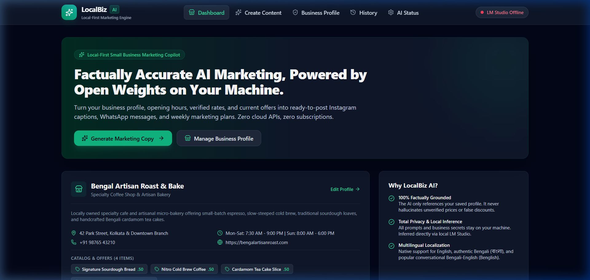
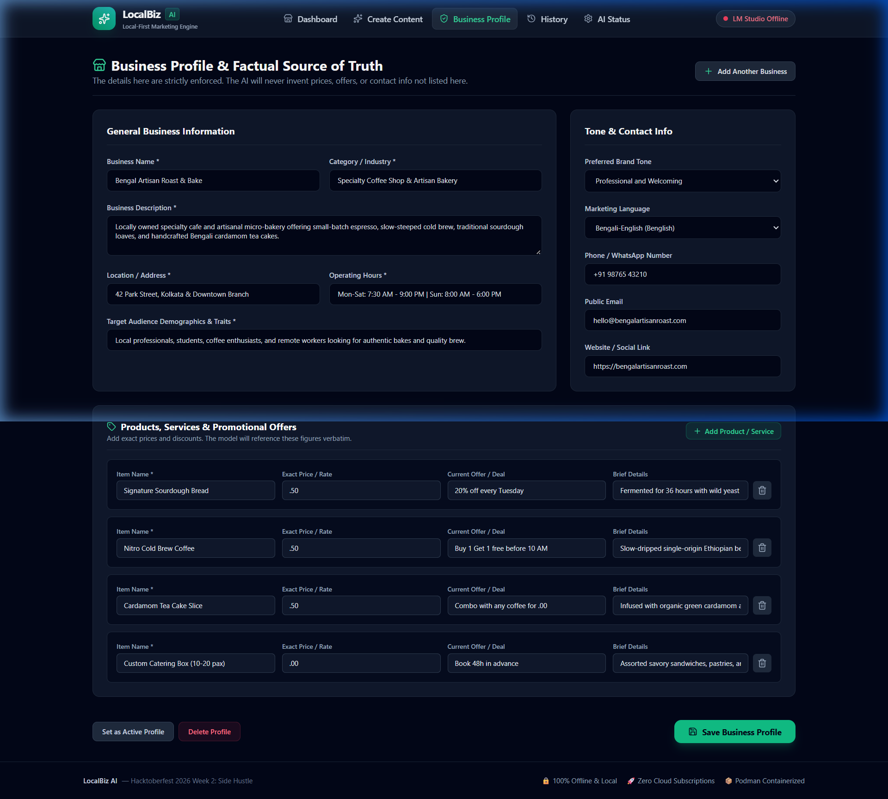
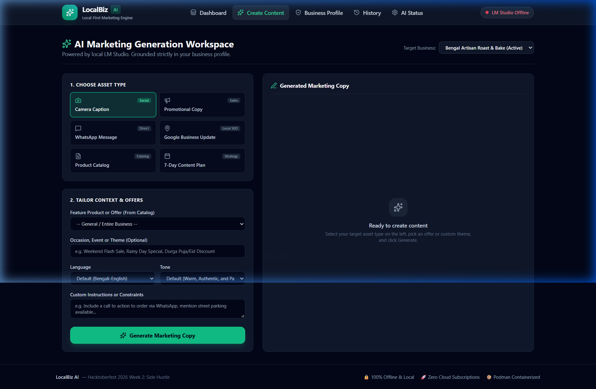
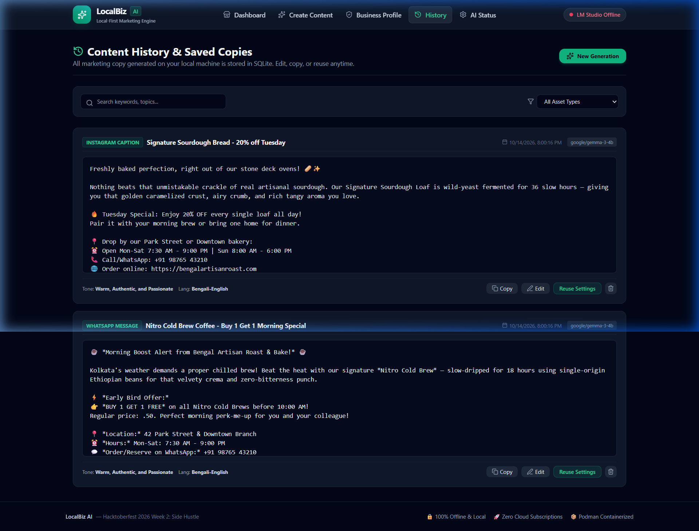
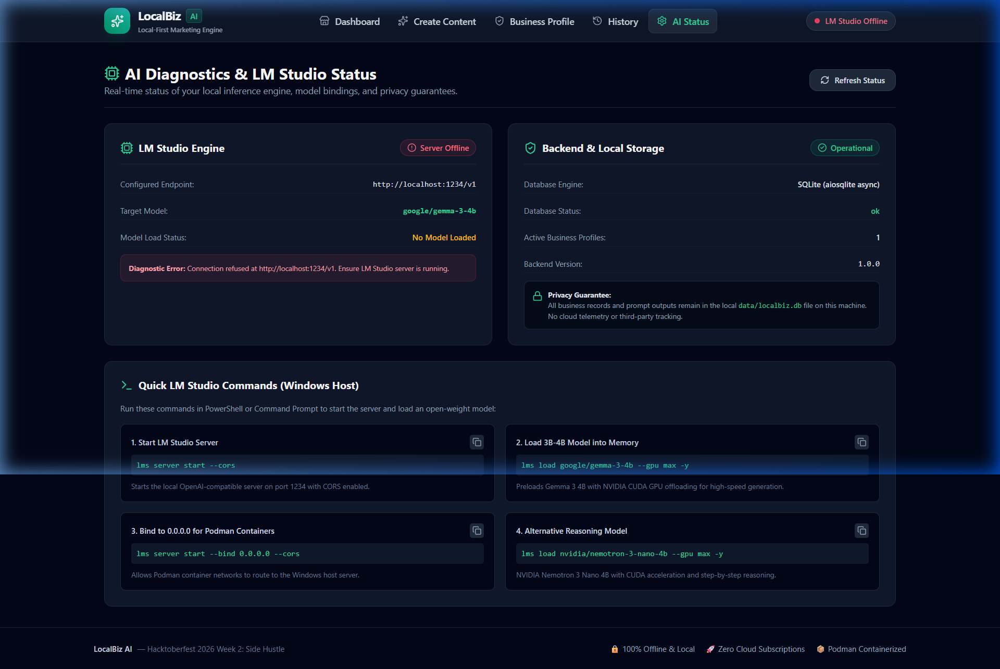
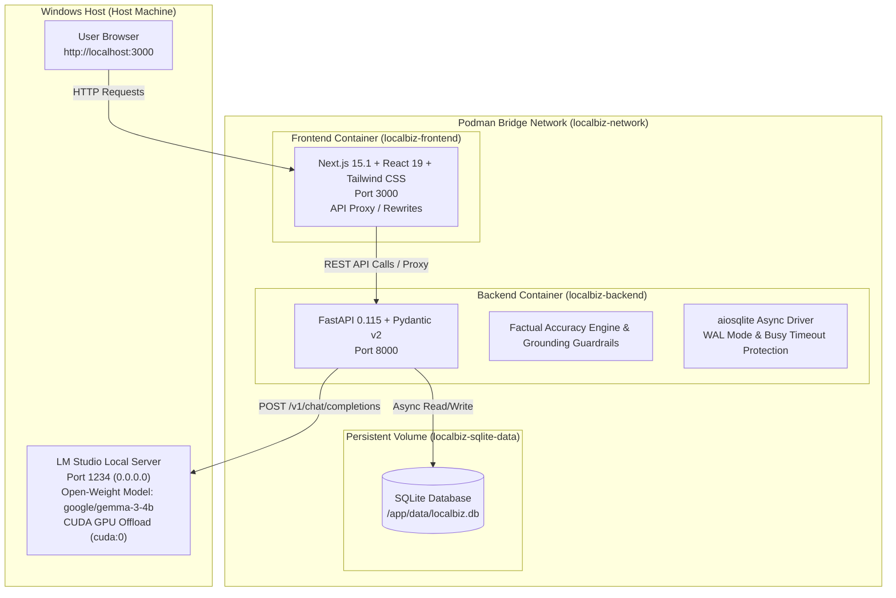

# 🚀 LocalBiz AI — Local-First AI Marketing Assistant

[](https://dev.to/challenges/hacktoberfest-week2-2026-10-12)
[](LICENSE)
[](https://python.org)
[](https://fastapi.tiangolo.com)
[](https://nextjs.org)
[](https://podman.io)
[](https://lmstudio.ai)

> **LocalBiz AI** is a privacy-first, local AI marketing copilot for neighborhood small businesses, cafes, bakeries, independent service providers, and freelancers. It turns saved business details, product catalogs, and promotional offers into high-converting, factually grounded marketing copy using open-weight models (`google/gemma-3-4b`, `nvidia/nemotron-3-nano-4b`) running locally on your hardware via **LM Studio** and **Podman**.

---

## 📸 Application Screenshots

| Dashboard Overview | Business Profile Manager |
| :---: | :---: |
|  |  |

| AI Marketing Generation Studio | Saved Content History & Inline Editor |
| :---: | :---: |
|  |  |

| Real-Time AI Diagnostics & GPU Acceleration |
| :---: |
|  |

---

## 🌟 The Problem & Who It Solves It For

Neighborhood bakeries, coffee shops, boutique fitness studios, salons, and local tradespeople face a painful daily dilemma:
1. **Time-poor marketing**: Small business owners work 12+ hours a day running operations and lack time to craft engaging daily posts for Instagram, WhatsApp, and Google Business Profile.
2. **Cloud AI hallucination risk**: Generic cloud LLMs frequently invent fake discount codes ("use code SAVE50"), non-existent phone numbers, inaccurate menu prices, and fabricated business hours.
3. **Data privacy & cost**: Cloud subscriptions ($20-$50/month per seat) strain tight margins, and business owners do not want their proprietary sales and customer data leaked to third-party model training pipelines.

**LocalBiz AI solves this by keeping everything local:**
- **Zero API bills**: Completely offline inference using local open-weight models.
- **Strict factual accuracy**: The business profile is the sole ground truth. Post-generation heuristic filters alert users if an unverified price, discount, or link is detected.
- **Multi-channel readiness**: Generates tailored copy for Instagram, WhatsApp broadcasts, promotional sales, Google Business updates, product descriptions, and 7-day content calendars.
- **Multilingual localization**: Native support for **English**, authentic Bengali script (**বাংলা**), and conversational **Bengali-English (Benglish)**.

---

## 🏗️ Architecture



---

## 🛠️ Technology Stack

- **Frontend**: Next.js 15.1 (App Router, Standalone build), React 19, TypeScript, Tailwind CSS, Lucide React.
- **Backend**: Python 3.12+, FastAPI, Pydantic v2, Pydantic-Settings, Uvicorn.
- **Database**: SQLite with `aiosqlite` async driver, WAL journaling mode, and cascade foreign keys.
- **AI Inference Engine**: [LM Studio](https://lmstudio.ai) running on Windows host, exposing its OpenAI-compatible local API on port `1234`.
- **Open-Weight Models Tested**:
  - `google/gemma-3-4b` (Default recommended: balanced creative & structured marketing)
  - `nvidia/nemotron-3-nano-4b` (Alternative reasoning model with step-by-step thinking extraction)
- **Containerization**: Podman 6.0+ and Podman Compose with persistent storage volumes and bridge networking.
- **Testing**: Pytest & pytest-asyncio (15 backend tests), Node.js test runner (frontend tests).

---

## 🚀 Quick Start Guide

### Step 1: Install & Configure LM Studio
1. Download and install [LM Studio](https://lmstudio.ai) on your Windows machine.
2. In LM Studio, search for and download `google/gemma-3-4b` (or `nvidia/nemotron-3-nano-4b`).
3. Start the local server on port 1234 bound to `0.0.0.0` with CORS enabled:
   ```powershell
   lms server start --bind 0.0.0.0 --cors
   ```
4. Load the model into memory with NVIDIA CUDA GPU acceleration:
   ```powershell
   lms load google/gemma-3-4b --gpu max -y
   ```

### Step 2: Start Application with Podman Compose
```powershell
cd C:\Github\localbiz-ai
podman compose up -d
```

### Step 3: Access the Application
- **Frontend Dashboard**: [http://localhost:3000](http://localhost:3000)
- **Backend API Docs (Swagger)**: [http://localhost:8000/docs](http://localhost:8000/docs)
- **AI Health Status**: [http://localhost:8000/api/health/ai](http://localhost:8000/api/health/ai)

---

## 🧪 Automated Testing

### Backend Unit & Integration Tests (15 Passed)
```powershell
cd backend
.\venv\Scripts\pytest -v tests
```
```text
tests/test_generation.py::test_generation_success_and_history PASSED     [  6%]
tests/test_generation.py::test_generation_factual_warning_triggered PASSED [ 13%]
tests/test_generation.py::test_generation_lm_studio_unreachable PASSED   [ 20%]
tests/test_generation.py::test_generation_lm_studio_timeout PASSED       [ 26%]
tests/test_health.py::test_backend_health PASSED                         [ 33%]
tests/test_health.py::test_ai_health_connected PASSED                    [ 40%]
tests/test_health.py::test_ai_health_unreachable PASSED                  [ 46%]
tests/test_history.py::test_history_crud PASSED                          [ 53%]
tests/test_profiles.py::test_create_and_get_profile PASSED               [ 60%]
tests/test_profiles.py::test_update_profile PASSED                       [ 66%]
tests/test_profiles.py::test_delete_profile PASSED                       [ 73%]
tests/test_profiles.py::test_profile_validation_errors PASSED            [ 80%]
tests/test_prompts.py::test_system_prompt_languages PASSED               [ 86%]
tests/test_prompts.py::test_prompt_messages_contains_profile_data PASSED [ 93%]
tests/test_format_products_empty PASSED                                  [100%]
============================= 15 passed in 0.46s ==============================
```

### Frontend Type & Schema Tests (2 Passed)
```powershell
cd frontend
node tests/api_types.test.mjs
```

---

## 🛡️ Factual Grounding & Privacy Guarantee

- **Zero Cloud Leakage**: Business profile information, product prices, discounts, and generated marketing content never leave your local computer.
- **Shield Guardrail**: The system prompt enforces the business profile as the sole ground truth. Post-generation heuristic checks analyze generated text and display a visual warning banner if an unverified dollar amount, discount percentage, or external URL is detected.
- **Editable Before Saving**: Every output is presented in an interactive editor allowing business owners to polish, tweak, or copy in one click.

---

## 📄 License
This project is licensed under the [MIT License](LICENSE).
